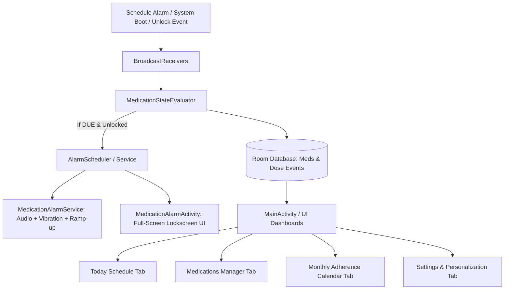

# MedWake (Wake-Gated Medication Alarm) - Complete Project Handoff

> **Project Name**: MedWake (`org.wakegated.medication`)  
> **Version**: 1.0.0 (Debug Build Complete & Verified)  
> **Target SDK**: Android 14+ (API 34/35/36 Compatible)  
> **License**: GPL-3.0 (derived from Fossify Clock) with attribution to MedTimer (MIT) for medication scheduling domain models.

---

## 📌 1. Executive Summary & Core Value Proposition

**MedWake** is a specialized, fail-safe Android medication reminder app engineered around the **Wake-Gated Alarm Paradigm**:
- **The Problem**: Traditional alarms ring at fixed times (e.g. 7:00 AM) regardless of sleep state, either startling users awake or getting dismissed while half-asleep and forgotten.
- **The Solution**: 
  - If a dose is scheduled for 7:00 AM and the user is still sleeping, the phone **remains completely silent**.
  - The moment the user unlocks their phone after 7:00 AM (e.g. at 7:35 AM), the app triggers a high-priority, persistent alarm after a configurable grace delay (0–15s).
  - Unlocking before the scheduled time (e.g. at 6:30 AM) does **NOTHING**.

---

## 🏛️ 2. Architectural Overview & Component Structure



### 📂 Key Source Code Directories

| Package / Directory | Description |
| :--- | :--- |
| `data.database` | Room database definition (`AppDatabase.kt`) & TypeConverters. |
| `data.entity` | Database entities: `MedicationEntity`, `ScheduleEntity`, `DoseEventEntity`. |
| `data.dao` | Room DAOs: `MedicationDao`, `ScheduleDao`, `DoseEventDao`. |
| `data.repository` | Clean Repository pattern: `MedicationRepository.kt`. |
| `domain.evaluator` | Deterministic state machine: `MedicationStateEvaluator.kt`. |
| `domain.manager` | `AlarmScheduler.kt`, `MedicationNotificationHelper.kt`. |
| `domain.model` | `ScheduleCalculator.kt` (bitmask schedules), `AdherenceCalculator.kt` (streaks). |
| `receiver` | `AlarmReceiver`, `BootReceiver`, `TimeChangeReceiver`, `ExternalActionReceiver`. |
| `service` | `MedicationAlarmService.kt` (Foreground service, gentle volume fade-in). |
| `ui` | `MainActivity.kt` (Tabs, settings, dialogs). |
| `ui.alarm` | `MedicationAlarmActivity.kt` (Lockscreen-capable alarm interface). |
| `ui.history` | `MonthlyAdherenceCalendarView.kt` (Interactive monthly adherence grid). |
| `ui.dashboard` | `DoseEventAdapter.kt` (Single-tap instant inline action handling). |
| `ui.medications` | `MedicationAdapter.kt` (Schedule bitmask summaries). |

---

## 🗄️ 3. Database Schema & State Lifecycle

### 3.1 Entities
1. **`MedicationEntity`** (`medications`):
   - `medicationId` (PK), `name`, `dosage`, `unit`, `wakeGated` (Boolean), `soundUri`, `soundTitle`, `vibrate`, `notes`, `stockQuantity`, `createdAt`.
2. **`ScheduleEntity`** (`schedules`):
   - `scheduleId` (PK), `medicationId` (FK), `timeInMinutes` (0..1439), `daysOfWeek` (7-bit mask: Mon=1, Tue=2, Wed=4, Thu=8, Fri=16, Sat=32, Sun=64).
3. **`DoseEventEntity`** (`dose_events`):
   - `doseEventId` (PK), `medicationId` (FK), `scheduledAt`, `dueAt`, `state` (`SCHEDULED`, `DUE`, `RINGING`, `TAKEN`, `SKIPPED`, `RESCHEDULED`, `MISSED`), `actionTimestamp`, `rescheduledFromId`.
   - **Unique Index**: `UNIQUE(medicationId, scheduledAt)` guarantees no duplicate alarms under concurrent triggers.

### 3.2 Dose State Transitions

```
[SCHEDULED] --(Clock >= Time & Screen Unlocked)--> [DUE]
    |                                                 |
    +--(Grace Delay Elapsed / Forced Ring)------------+--> [RINGING]
                                                               |
            +-------------------+------------------------------+
            |                   |                              |
            v                   v                              v
        [TAKEN]             [SKIPPED]                   [RESCHEDULED]
                                                               |
                                                               v
                                                 (Creates new [SCHEDULED] event)
```

---

## ⚙️ 4. Feature Matrix & Implementation Details

### 4.1 Alternating Schedules (e.g. Mon-Wed-Fri-Sun vs Tue-Thu-Sat)
- Implemented in `ScheduleCalculator.kt`:
  - `PRESET_EVERYDAY = 127` (all 7 days)
  - `PRESET_MWF_SUN = 85` (Mon, Wed, Fri, Sun)
  - `PRESET_TTS = 42` (Tue, Thu, Sat)
  - `PRESET_WEEKDAYS = 31` (Mon through Fri)
  - `PRESET_WEEKENDS = 96` (Sat, Sun)
- Interactive 7-Day Toggle Bar (`M T W T F S S`) in `dialog_add_medication.xml` with equal weights (`1f`) to prevent truncation on compact screens.

### 4.2 Monthly Adherence Calendar & Streak Tracking
- **Custom View**: `MonthlyAdherenceCalendarView.kt`
  - Displays complete month in 7 weekday columns with `< Month Year >` pagination.
  - Days color-coded: **Green** (100% Taken), **Red** (Skipped/Missed), **Yellow** (Partial), **Grey** (No schedule).
  - Tapping any calendar day filters the dose list below to inspect events for that specific date.
- **Calculator**: `AdherenceCalculator.kt` computes `currentStreakDays`, `bestStreakDays`, and monthly adherence percentage.

### 4.3 Interactive Dose Status Editor
- Tapping any past or current dose card opens `dialog_edit_dose_status.xml`.
- Users can correct past records: change Skipped to `✓ Mark as Taken`, change Taken to Skipped, Reschedule (+15m, +30m, +1h, +2h, Pick Time), or Delete record.

### 4.4 Gentle Volume Ramp-Up (Fade-In)
- Configured in Settings (`KEY_GENTLE_VOLUME_ENABLED`, `KEY_GENTLE_VOLUME_SECONDS`: 5s to 30s).
- `MedicationAlarmService.kt` starts audio playback at a whisper-quiet 5% volume (`0.05f`) and steps up to 100% volume in 500ms increments.
- Includes a live `[▶ Test Volume Fade-In]` preview button in Settings.

### 4.5 Alarm Appearance & Custom Wallpaper Personalization
- **5 Built-in Color Themes**:
  - `Electric Blue` (`#2563EB` - Default matching reference design)
  - `Emerald Green` (`#006C4C`)
  - `Midnight Slate` (`#0F172A`)
  - `Sunset Rose` (`#E11D48`)
  - `Royal Purple` (`#7C3AED`)
- **Mascot & Background Modes**:
  - `Custom Wallpaper`: Clean placeholder card + native gallery photo picker (`[🖼 Pick Wallpaper]`).
  - `Pillo Robot Mascot`: Vector companion robot with cyan animated eyes.
  - `Minimalist Theme`: Clean distraction-free view.
- **Live Preview**: `[▶ Preview]` button in Settings launches the alarm screen for immediate verification.

---

## 🔒 5. Android 14 / 15 / 16 Platform Compliance

1. **Exact Alarms (`SCHEDULE_EXACT_ALARM`)**:
   - Runtime checks using `AlarmScheduler.canScheduleExact()`.
   - Fallback deep link to `Settings.ACTION_REQUEST_SCHEDULE_EXACT_ALARM` in Settings.
2. **Full-Screen Intent (`USE_FULL_SCREEN_INTENT`)**:
   - Checked via `NotificationManager.canUseFullScreenIntent()` on Android 14+ (UPSIDE_DOWN_CAKE).
   - High-importance heads-up notification fallback with inline action buttons (`Take`, `Skip`, `Snooze`).
3. **Battery Optimization Exemption**:
   - `Settings.ACTION_REQUEST_IGNORE_BATTERY_OPTIMIZATIONS` handler provided for OEM battery savers (Samsung One UI, Xiaomi MIUI).
4. **Lockscreen Visibility**:
   - `setShowWhenLocked(true)`, `setTurnScreenOn(true)`, and `KeyguardManager.requestDismissKeyguard()` in `MedicationAlarmActivity.kt`.

---

## 🛠️ 6. Build, Test & Maintenance Guidelines

### 6.1 Host JVM & Worker Resource Rules
Due to 20-thread CPU host constraints, always invoke Gradle with:
```bash
./gradlew testDebugUnitTest assembleDebug --no-daemon --max-workers=2
```

### 6.2 Environment Setup
```bash
export ANDROID_HOME=/home/adeln/Android/Sdk
export JAVA_HOME=/home/adeln/.local/share/jvm/jdk-21
export PATH=$JAVA_HOME/bin:$ANDROID_HOME/platform-tools:$PATH
```

### 6.3 Automated Test Suite
- `ScheduleCalculatorTest.kt`: Validates bitmask operations and day calculations.
- `AdherenceCalculatorTest.kt`: Validates streak counts and month adherence summaries.

### 6.4 Useful ADB Test Commands
```bash
# Install & Grant Permissions
adb -s emulator-5554 install -r app/build/outputs/apk/debug/app-debug.apk
adb -s emulator-5554 shell pm grant org.wakegated.medication.debug android.permission.POST_NOTIFICATIONS

# Create Test Due Dose
adb -s emulator-5554 shell am broadcast -a org.wakegated.medication.ACTION_CREATE_TEST_DOSE -p org.wakegated.medication.debug

# Trigger Wake-Gated Alarm Presentation
adb -s emulator-5554 shell am broadcast -a org.wakegated.medication.ACTION_SHOW_DUE_ALARM -p org.wakegated.medication.debug
```

---


## 📋 7. Session Status — 2026-08-25 Bug Hunt & Fix Batch (supersedes prior session notes)


Full findings: `~/.opencode/plan/BUGS_FOUND.md` · Test protocol: `~/.opencode/plan/medwake-real-device-testing-plan.md` · Evidence: `/tmp/opencode/medwake-tests/` (~90 files, **/tmp — copy to keep**).


### 7.1 Live-proven bugs (pre-fix)

| # | Sev | Bug |

|---|-----|-----|

| B1 | Critical | "Take Now" on med with stock: stale entity write-back in `MedicationRepository.resolveDoseEvent()` reverts dose to RINGING → infinite alarm loop |

| B2 | Critical | Editing a med wipes its dose history (`INSERT OR REPLACE` → FK CASCADE) and re-arms past doses |

| B27 | Critical | Post-reboot alarm lost: emulator BAL block (code 102); real device `ForegroundServiceStartNotAllowedException` (FGS mediaPlayback from BOOT_COMPLETED) + app-open crash loop |

| B25 | Low/High | Battery-exemption button dead on API-34 emulator (missing manifest permission); works on Samsung/Android 16 |

| B5 | High | Wallpaper lost after process death (picker URI not persisted) |

| B29 | Medium | Calendar month nav shows stale previous-month colors/% |

| B14/B19/B28/B16/B10 | Low | Future events in History · zero-day schedule saves · invisible name error · truncated notif actions · Preview leaks permanent meds |


Wake-gate core passed: locked→silent, unlock→rings, unlocked→immediate, midnight rollover, rotation, no crashes. Not triggered: B4, B6, B8, B20.


### 7.2 Fix batch (all 10 applied, APK rebuilt 21:30, unit tests 6/6 PASS)

F1 `DoseEventDao.markStockHandled()` targeted UPDATE · F2 edit path `upsertSchedule()` · F3 FGS try/catch + FSI-notification fallback + service coroutine guard · F4 `OpenDocument` + `takePersistableUriPermission` · F5 zero-day toast guard (`MainActivity.kt` Save handler) · F6 name-required toast · F7 History future-event filter · F8 month-change summary recompute · F9 short notification labels · F10 Silent-preview guard.


### 7.3 Verification status

- ✅ **ALL VERIFIED**: V1 (B1) · V2 (B2) · V3 (B27 emulator reboot) · V4 (B5 wallpaper persistence) · V5 (B19 zero-day guard — toast + save blocked) · V6 (B14 no future SCHEDULED in History) · V7 (B29 month nav recomputes, Aug 9%↔Sep 100%) · V8 (B16 short labels "Take"/"Skip"/"Snooze"). Evidence: `FIX_V1..V8_*` in `/tmp/opencode/medwake-tests/`.
- Cleanup DONE: emulator wiped to pristine (`pm clear` + POST_NOTIFICATIONS re-grant + battery whitelist; 0 meds / 0 events, `FIX_cleanup.png`). V5 note: day-button taps need a fresh uiautomator dump per tap — each toggle re-layouts the dialog (`cgPresets.clearCheck()`).
### 7.4 Environment notes

- Emulator `emulator-5554` (Android 14, 320×640, screenshot px = tap coords); phone `R5CW21ZV0MB` (S24+, Android 16) has the app installed with empty data, kept per owner.

- Room DB file on device: `databases/medwake_database.db` (NOT `medwake_database`) — query the `.db` file.

- Project has **no git repo** — the fix batch exists only as working-tree files. Recommended next: `git init` + commit, then update TESTING.md matrix with fix statuses.

- Harness adb pitfalls: ESC cancels dialogs; IME shifts dialog buttons (`adjustResize`) — re-dump uiautomator after keyboard dismissal; toasts need screencap within ~0.6s.

### 7.5 Batch 2 — 2026-08-26 (user-reported from phone, all fixed & emulator-verified)
- **B30 dark mode**: `values-night/colors.xml` added; hardcoded gray text → `@color/text_secondary`/`@color/on_surface`. All tabs legible in night mode.
- **B31 FSI**: `USE_FULL_SCREEN_INTENT` added to manifest; emulator reports "Granted ✓". On the phone: install new APK, then flip the (now-enabled) Full screen alerts toggle if the system still shows it revoked.
- **B32 phantom alarm + false SKIPPED**: past occurrences (>60s old at insert) are now created as **MISSED** (new amber "● MISSED" badge in Today/History + dose dialog) — no more instant ring after saving a med, no more unexplained SKIPPED entries. Verified: future med silent; clock-advance rings normally; past-time med files MISSED silently.
- Build + unit tests PASS (6/6). APK rebuilt — reinstall on the phone to pick up Batch 1+2.

### 7.6 Batch 3 — 2026-08-26 (alarm presentation robustness, emulator-verified)
- **B33 swipe-away**: exact alarm verified firing after swipe on stock Android (receiver + notification + full-screen). On One UI, swipe may force-stop; device-side mitigation = battery unrestricted / not in sleeping apps.
- **B34 re-present**: BACK while ringing minimizes instead of finishing; onStop re-launches the alarm after 1.5s — BAL-exempt via new `SYSTEM_ALERT_WINDOW` permission + Settings row "Display over other apps" (deep-link button). FSI covers locked-screen auto-launch (Android auto-launches FSI only when locked).
- **B35 notification**: alarm notification (Take/Skip/Snooze) now posted on EVERY ringing transition — previously only in the FGS-denied fallback (why sound played with no UI). Cancelled on resolve; onPause re-posts cancel-then-repost so FSI re-fires fresh.
- Build + tests PASS. Final APK (11:03) declares USE_FULL_SCREEN_INTENT + SYSTEM_ALERT_WINDOW (aapt-verified).
- **OPEN ISSUE on the phone (escalated)**: after swipe-away the alarm still doesn't ring on One UI, and a dose can sit "DUE (Waiting for unlock)" while the phone is unlocked+in use. Full context + hypotheses + questions: `~/handoffs/20260826-113000-medwake-alarm-not-firing.md`. Pending higher-AI advice; not fixed in this batch.

### 7.7 Batch 4 + escalation fix — 2026-08-26 evening (unlock-monitor deleted, phone-deadlock design)
- **Deleted `UnlockMonitorService`** (FGS-based unlock waiter was process-death-fragile / Samsung kills FGS). Unlock gating is now `isInteractive()` only; keyguard state removed from the ring gate (it's legitimately true while viewing an over-keyguard activity).
- **Two channels**: `alarm_ringing` (sound) + `alarm_due` (high, silent FSI) — the DUE notification is the unlock waiter: SystemUI holds the FSI and launches the alarm over the lockscreen on wake, surviving process death.
- **30-min safety-net**: DUE → RINGING after 30 min regardless of lock state; folded into the single next-wakeup alarm chain.
- **MainActivity.onResume evaluates** (`launchFullScreenActivity=true`); **MedicationAlarmActivity.onStart** starts audio when keyguard clear, else `requestDismissKeyguard` + in-activity USER_PRESENT receiver.
- **Audio idempotency** guard; **debug event log** (`filesDir/medwake_events.log`) + Settings Debug Events card — the phone-diagnosis tool for the next device test.
- **Batch 4**: B22 receiver locked (`exported=false`), B21 schema sealed (v3, validating migration, destructive fallback removed — note: execSQL(SELECT) crashes, use db.query), B7 onNewIntent, B9 snooze collision retry (+60s ×5), B11 real delete.
- Build + tests PASS. Emulator: migration 2→3 verified live. **Phone: reinstall; next device test should be done WITH the Debug Events card open on failure.**

### 7.8 Batch 5 — 2026-08-26 night (onboarding, edit cleanup, keyguard-precise wake-gate, delay input) — all emulator-verified PASS
- B36: first-launch POST_NOTIFICATIONS request + one-time "Set up MedWake" grants dialog (`onboarding_done` flag).
- B37: editing a schedule deletes the med's pending SCHEDULED/DUE events — no phantom ring at the old time, no spurious MISSED; re-expansion rebuilds correct occurrences.
- B38: wake-gate now requires `interactive && !keyguardLocked` — screen-on while keyguard showing stays silent (DUE + silent FSI over keyguard); rings only after actual unlock. Verified screen-off→DUE, screen-on-locked→DUE no audio, unlock→ring.
- B39: unlock delay input is now a numeric field 0–120s (fixed/random modes), replacing the 0–15s slider.
- Verification notes: parallel attempt with a 2nd emulator failed (clone AVD dies at boot on this host — 3 attempts) → checks ran sequentially on emulator-5554; all PASS. Onboarding/delay verified on fresh install; edit-cleanup verified with clock control; keyguard verified with PIN keyguard + wm dismiss-keyguard.
-
### 7.9 Batch 6 — 2026-08-28 (strict unlock-only ring gate; escalation review applied) — emulator-verified
- **Bug (user-reported)**: dose at 06:40 stayed silent at 06:40 (correct), then rang exactly when the phone's own alarm rang, phone still locked. Root cause: three audio gates (evaluator `interactive && !isDeviceLocked && !isKeyguardLocked`, activity `onStart` `!isDeviceLocked`, activity `ACTION_SCREEN_ON` receiver `!isDeviceLocked`) treated screen-on as unlocked; on swipe keyguards `isDeviceLocked()` is false even while locked; `isKeyguardLocked()` reads false under showWhenLocked coverage.
- **Escalation**: design review relayed from a higher AI (handoff `~/handoffs/20260828-085031-medwake-strict-unlock-gating.md`). Applied with 3 corrections/refinements (KEYGUARD_HIDDEN-only oracle — their code sample's SCREEN_INTERACTIVE would re-introduce the bug; recent-only corroboration window; RINGING-never-demotes).
- **B40 single gate**: evaluator is the only DUE→RINGING decision point and only `MedicationAlarmService` caller. Activity `onStart` = Room-state-only resume (RINGING → start service; else finish); deleted `ACTION_SCREEN_ON` receiver, USER_PRESENT receivers in the activity, `requestDismissKeyguard`, manifest `UserPresentReceiver` (dead on modern Android).
- **B41 unlock oracle**: `UnlockOracle` — UsageStats `KEYGUARD_HIDDEN` (system-logged, survives process death; swipe + credential locks) + in-process/prefs USER_PRESENT fallback; dynamic USER_PRESENT receiver in `MedWakeApp` records + fast-path evaluates.
- **B42 opt-in settings**: Quick-open catch-up (ring if real unlock happened within window after due and re-locked before the poll) + window 5–120s; Safety net (ring while locked) + 10–60 min, default OFF; usage-access row + deep link; "When MedWake rings" info card; ring-decision log (`filesDir/medwake_events.log`) + Settings debug card; FSI runtime check (`canUseFullScreenIntent` + heads-up fallback); backup export/import of new keys.
- **B43 fixes from re-verification**: cold-start settle rule (`KEYGUARD_SETTLE_MS` 4s — keyguard window not laid out at process start → transient `isKeyguardLocked()==false` → false ring; suppressed unless oracle corroborates an unlock within 30s); RINGING state never demoted by the gate; stop-audio guard when nothing is RINGING.
- **Verification (emulator-5554, API 34, swipe keyguard — the bug class)**: T1 screen-on-while-locked SILENT (ring log `1787904763921|alarm|true|true|...|due` — interactive=true, keyguardLocked=true at poll); T2 unlock rings (`...|ring` with keyguard=false); T3 quick-open positive (120s window) + negative (5s window); T4 safety-net OFF default → silent while locked 10+ min (the T+10min "ring" was a legit liveUnlocked, not safety net); T5 non-wake-gated rings while locked; T6 regression smoke. Unit tests 17/17 (RingGateTest 11 + 3 existing classes). Re-tests after B43 fixes: cold-start-while-locked → `due`; unlock → `ring`.
- **Known limitation (documented in-app)**: quick-open catch-up needs the unlock to be observed — UsageStats covers process-dead unlocks; without usage access it only catches unlocks while the process is alive. Usage events can lag one chaser cycle (~90s) on some builds.
-
### 7.10 Batch 6.1 — 2026-08-28 (phone false-ring fix: oracle-corroborated unlock) — emulator-verified, phone pending
- **User-reported on the S24+ (v1.1.0)**: rang while locked + screen off. Ring log: `alarm|true|false|...|ring` — `interactive=true, keyguardLocked=false` at the chaser. Root cause: the keyguard API is unreliable on real devices at alarm-wake (keyguard window not laid out yet) and under showWhenLocked occlusion (the phone's own alarm screen) → reads FALSE while locked → liveUnlocked gate passes.
- **Fix (v1.1.1)**: "unlocked" is now corroborated by real unlock events, not keyguard reads. `UnlockOracle.isUnlockedAfterLastScreenOff()`: UsageStats `KEYGUARD_HIDDEN` (or USER_PRESENT) newer than the last `KEYGUARD_SHOWN`/`SCREEN_NON_INTERACTIVE` barrier → genuinely unlocked (system-logged, survives process death, immune to occlusion); fallback = prefs USER_PRESENT vs SCREEN_OFF (MedWakeApp now records SCREEN_OFF). Un-corroborated liveUnlocked rings are deferred by a 10s stability re-check (`KEYGUARD_STABILITY_MS`) — a transient/occluded false read resolves to `due`. `!isDeviceLocked` restored to the gate. Ring log gains a `corroborated` field.
- **Emulator-verified**: cold start while locked → `due` (corroborated=false); unlock (`wm dismiss-keyguard` → KEYGUARD_HIDDEN) → `corroborated=true → ring`. Unit tests 17/17, build green.
-
### 7.11 Batch 7 — 2026-08-28 (v1.2.0 restore + minimal fix; higher-AI judgment round) — emulator-verified, phone v1.2.0 installed
- **User directive**: restore the working v1.0.1 behavior first; add only provably-safe improvements; minimal fix for the phone-alarm false ring; gather all tests for the higher AI's judgment.
- **v1.2.0**: restored v1.0.1 gate/flow (`interactive && !isDeviceLocked && !isKeyguardLocked`, unlock-delay, escalation-aware scheduling), REMOVED the Batch-6.1 stop-audio guard (it started the service with ACTION_STOP_ALARM every eval and the service's stop path cancelled the DUE notification — the "persistent notification lost" regression), removed the 10s stability deferral, kept RINGING-never-demotes + ring log + FSI check; minimal fix = corroborated unlock (`KEYGUARD_HIDDEN` after `KEYGUARD_SHOWN`/`SCREEN_NON_INTERACTIVE` barrier, or USER_PRESENT log) via `RingGate.effectiveLiveUnlocked(liveUnlocked, corroborated, usageAccess)`; safety net OFF by default (owner preference) with range 10–300 min; version 1.2.0/6.
- **Judgment round (higher AI)**: fault-injection flag (`debug_force_poison`, BuildConfig.DEBUG) — poisoned read + usage access → `due`; without access → `ring` (documented fallback hole, nudge hint extended). Race sweep 20/20 (deltas 0/1/5/8/30s) → all `due`. Ring→force-stop→restart → re-presented. Full chain (schedule→exact alarm→receiver→evaluator): locked → `due|832` silent; unlock → corroborated `ring|832`. Reinstall with pending DUE → no phantom ring, notification persists. Pure `unlockedAfterBarrier` extracted + 6 unit tests → **27/27**.
- **Gating fact VERIFIED**: S24+ records `KEYGUARD_HIDDEN` (884 events; 143 today incl. real PIN/biometric lock/unlock pairs) — the corroboration layer has its data source on One UI. Phone has a SECURE keyguard (owner: PIN/fingerprint); lock via adb OK, unlocks must be owner-performed.
-
### 7.12 Batch 8 — 2026-08-28 (FSI/overlay regression root-caused + quick-open duration semantic; phone live-verified)
- **FSI/overlay regression (user-reported: "before I could grant them, now I can't") — ROOT CAUSE: my own manifest edit.** When `PACKAGE_USAGE_STATS` was added (v1.1.2), the edit accidentally deleted `<uses-permission USE_FULL_SCREEN_INTENT>` and `<uses-permission SYSTEM_ALERT_WINDOW>` from AndroidManifest.xml. Evidence: `aapt dump permissions` on the old APK lists USE_FULL_SCREEN_INTENT; the v1.1.2+ APK listed neither. Samsung then treated the app as not requesting them → FSI toggle `enabled=false`, app absent from the "Appear on top" list (the earlier "Samsung eligibility policy" conclusion was wrong; the eligibility flipped because the manifest lost the permissions). Fix: restored both lines (v1.2.1). Verified on the phone: FSI toggle `enabled=true checked=true` (auto-granted at install), MedWake back in the overlay list, overlay grantable.
- **Quick-open catch-up semantic change (v1.2.2)**: was "last unlock within the window of the poll" (recency) — owner's real test missed by 6.5 s (13 s unlock, 5 s window, poll 19.5 s after unlock start). Now: **longest continuous unlock episode since the dose became due ≥ the window → ring at the next poll** (`UnlockOracle.longestUnlockDurationMs` walking KEYGUARD_HIDDEN→SHOWN/NON_INTERACTIVE episodes; `RingGate.decide` takes `longestUnlockSinceDueMs`). Setting label renamed "Minimum unlock duration seconds (5-120)". Unit tests 26/26. **Owner live-verified all cases on the phone** (Case A long unlock → ring; Case B 5–10 s glance → ring; Case C 1–2 s blip → no ring).
- **Phone live chain test (v1.2.0/1.2.1)**: UI-added wake-gated dose due 14:26 → locked → `alarm|...|due|581` silent + persistent notification; owner's real PIN unlock with the app process dead → chaser caught `KEYGUARD_HIDDEN` → `corroborated=true → ring` (~65 s, designed ≤90 s bound); audio + ringing notification + fullscreen activity; TAKE NOW → TAKEN cleanly.
- Evidence: `/tmp/medwake-batch6/v12/phone_*.png`. APK: `/sdcard/Download/medwake-v122.apk` on the phone; `app/build/outputs/apk/debug/app-debug.apk` (v1.2.2). **Open**: 7-day canary + final 06:40 re-test on v1.2.2.
