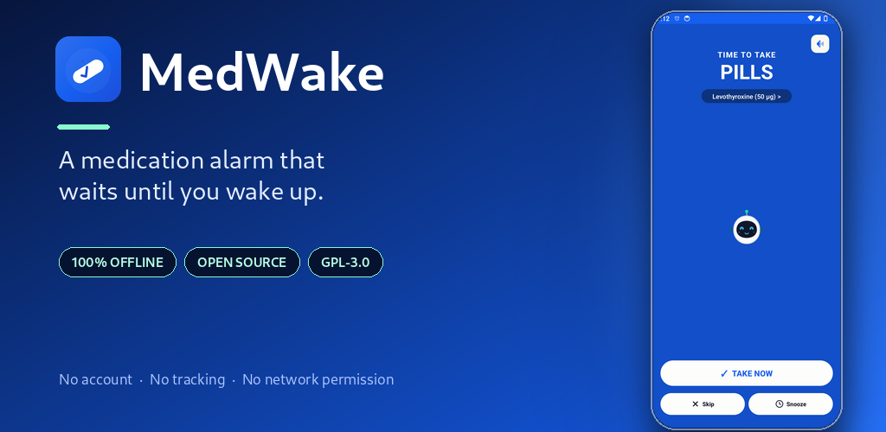
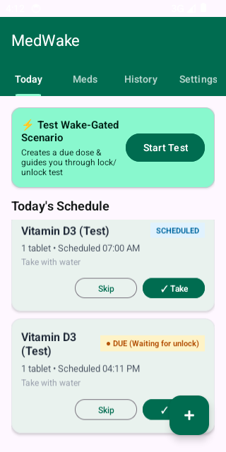
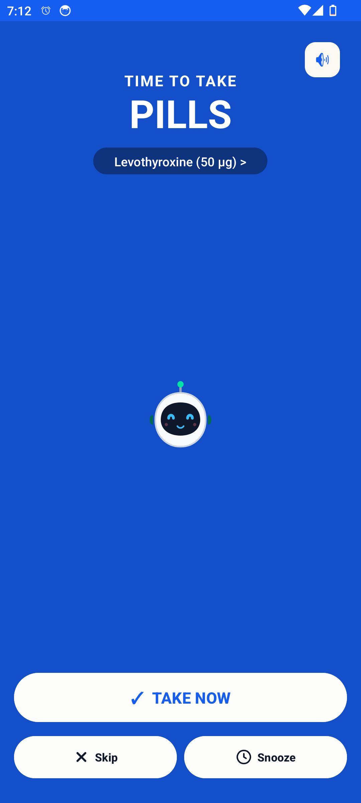
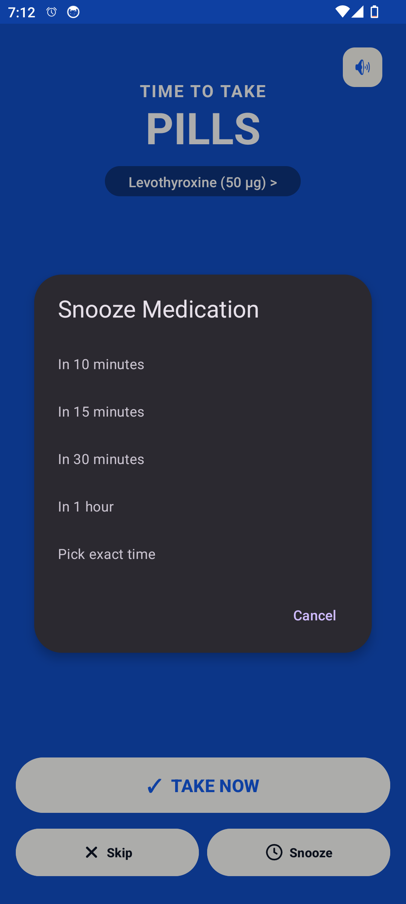
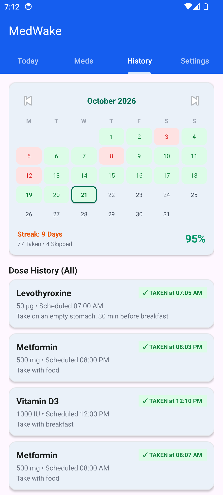
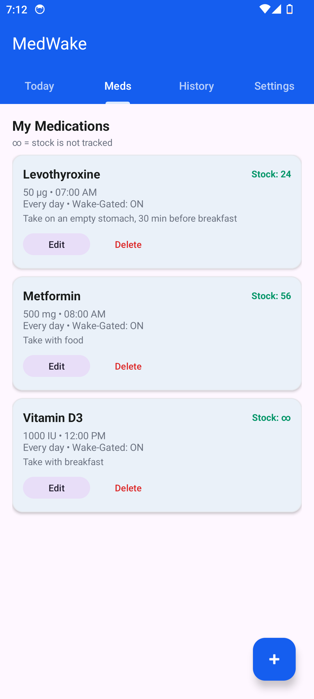
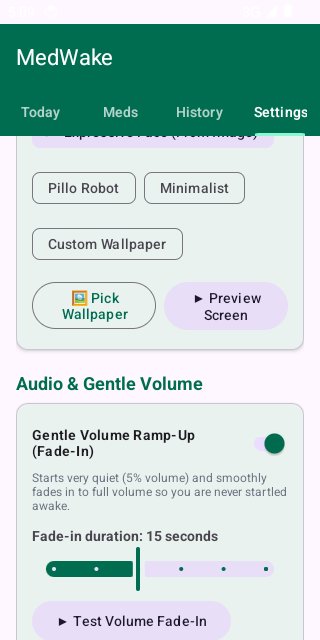
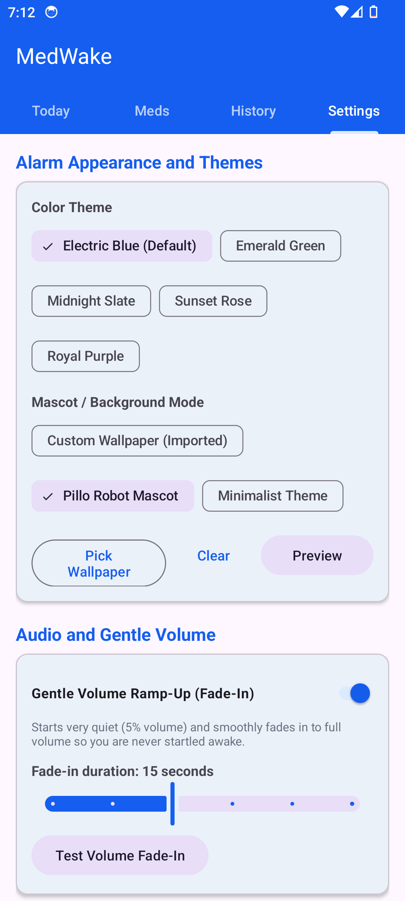
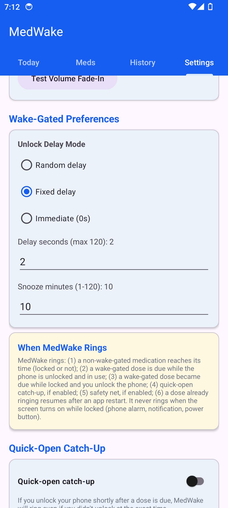

# MedWake

**A medication alarm that waits until you wake up.**

[](https://github.com/adeldev-lab/MedWake/releases/latest)
[](LICENSE)
[](https://developer.android.com/about/versions/oreo)
[](PRIVACY.md)
[](https://gitlab.com/fdroid/fdroiddata/-/merge_requests/53573)

<p align="center">
  
</p>

MedWake is a free, open-source, offline medication reminder for Android
(Android 8.0+, optimized for Android 14–16 and Samsung One UI). It does not wake
you at 07:00 just because a dose is due. It waits until you pick up and unlock
your phone, then shows a full-screen alarm.

---

## Why "wake-gated"?

Traditional medication alarms either startle you awake at a fixed time or get
lost in the notification tray. MedWake separates two things:

> **A dose becoming due is not the same as the user being available.**

1. **07:00 — the dose becomes DUE.** If the phone is locked and you are asleep,
   MedWake is completely silent.
2. **07:12 — you unlock the phone.** MedWake notices the real unlock, waits for
   the configured delay (0–120 s), and presents the full-screen alarm.
3. **Already using the phone at 07:00?** The alarm rings immediately.
4. **Snoozed?** The replacement dose becomes due at the new time and rings on
   your next unlock — not while the phone is locked.

The unlock signal is corroborated with the system's own keyguard events
(optional usage access), so turning the screen on while locked — for a phone
alarm, a notification or the power button — does **not** trigger MedWake.

---

## Screenshots

<p align="center">
  <a href="fastlane/metadata/android/en-US/images/phoneScreenshots/1.png"></a>
  <a href="fastlane/metadata/android/en-US/images/phoneScreenshots/5.png"></a>
  <a href="fastlane/metadata/android/en-US/images/phoneScreenshots/6.png"></a>
  <a href="fastlane/metadata/android/en-US/images/phoneScreenshots/3.png"></a>
</p>
<p align="center">
  <a href="fastlane/metadata/android/en-US/images/phoneScreenshots/2.png"></a>
  <a href="fastlane/metadata/android/en-US/images/phoneScreenshots/4.png"></a>
  <a href="fastlane/metadata/android/en-US/images/phoneScreenshots/7.png"></a>
  <a href="fastlane/metadata/android/en-US/images/phoneScreenshots/8.png"></a>
</p>

## Demo videos

- [Feature tour](docs/media/medwake-tour.mp4) — dashboard, medication editor,
  history, alarm and settings.
- [Wake-gated alarm & snooze](docs/media/medwake-wake-gated.mp4) — a dose is
  due while the phone is locked, rings on the first unlock, is snoozed, and
  rings again after the snooze when the phone is unlocked.

> The demo uses an original two-tone chime. Samsung's "Glitter" tone is
> proprietary and is not redistributed; by default MedWake uses the phone's
> own system alarm sound, which on a Samsung can be Glitter.

---

## Features

- **Wake-gated full-screen alarm** — Take now, Skip, Snooze or reschedule.
- **Snooze that respects the gate** — a snoozed dose only rings after the new
  time, and only once the phone is really unlocked.
- **Gentle volume ramp-up** — 5% to 100% over 5–30 seconds.
- **Monthly adherence calendar** — taken, skipped and missed days, current
  streak and adherence percentage.
- **Flexible schedules** — every day, weekdays, weekends, Mon/Wed/Fri/Sun,
  Tue/Thu/Sat, or any custom day combination.
- **Stock counts and low-stock warning** (∞ means stock is not tracked),
  with editable dose history.
- **Five alarm themes**, a robot mascot or your own wallpaper.
- **Local backup/restore** via a JSON file you choose.
- **Optional quick-open catch-up and safety-net reminders.**
- **Standalone and offline** — no account, no cloud, no root, no Tasker, no ADB.

## Install

### GitHub Releases (signed APK)

Download the latest `MedWake-v*.apk` from
[Releases](https://github.com/adeldev-lab/MedWake/releases/latest), then open
it on the phone. Each release also includes a SHA-256 checksum.

> The GitHub APK is signed with the project's release key. If you later switch
> to an F-Droid build (which F-Droid signs with its own key), uninstall the
> GitHub build first; Android will not update across different signatures.

### Obtainium

In [Obtainium](https://github.com/ImranR98/Obtainium), tap **Add App** and paste:

```
https://github.com/adeldev-lab/MedWake
```

Obtainium will follow the GitHub releases and offer updates when a new tag is
published.

### F-Droid

F-Droid submission is **open for review** in
[fdroiddata !53573](https://gitlab.com/fdroid/fdroiddata/-/merge_requests/53573)
(application ID `org.wakegated.medication`). Once the merge request is
accepted, the listing will be available at:

```
https://f-droid.org/packages/org.wakegated.medication/
```

## Privacy

MedWake requests **no internet permission**. Everything — medications,
schedules, dose history, preferences — stays in the app's private database on
the phone. There are no accounts, ads, analytics or crash reporters.

The optional usage-access grant is used only to read keyguard events
(`KEYGUARD_HIDDEN` / `KEYGUARD_SHOWN`) to corroborate a real unlock. It is never
used to see which apps you use. See [PRIVACY.md](PRIVACY.md) for the full
policy and every permission.

## Build

Requirements: JDK 21 and Android SDK platform 35 / build-tools 35.

```bash
# Unit tests + release APK
./gradlew testDebugUnitTest assembleRelease --no-daemon --max-workers=2

# Debug APK (applicationId ends in .debug)
./gradlew assembleDebug --no-daemon --max-workers=2
```

Release signing reads `keystore.properties` (or the `SIGNING_*` environment
variables used by the GitHub Actions workflow). Never commit keystores or
passwords.

## Project docs

- [ARCHITECTURE.md](ARCHITECTURE.md) — data model, state machine and alarm flow
- [TESTING.md](TESTING.md) — test matrix and manual verification steps
- [PRIVACY.md](PRIVACY.md) — permissions and data handling
- [NOTICE.md](NOTICE.md) — upstream attribution
- [fdroid recipe](docs/fdroid/org.wakegated.medication.yml) — the metadata
  submitted to the F-Droid repository

## License and credits

MedWake is free software under the **GNU General Public License v3.0**
([GPL-3.0-only](LICENSE)).

- **Fossify Clock** (GPL-3.0, Copyright (C) FossifyOrg) — alarm scheduling,
  audio playback and gentle volume ramp-up patterns.
- **MedTimer** (MIT, Copyright (c) Futsch1) — medication domain concepts and
  scheduling models.

## Disclaimer

MedWake is a reminder tool, not a medical device and not medical advice. The
operating system, the device vendor or the user can always prevent an alarm
from firing (for example by force-stopping the app, revoking permissions or
aggressive battery management). Always follow your prescriber's instructions
and keep a backup reminder for critical medication.
